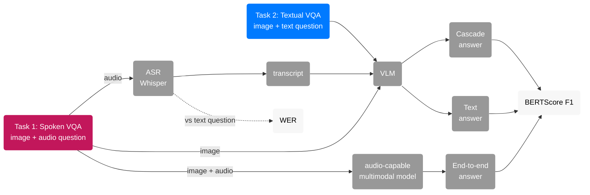
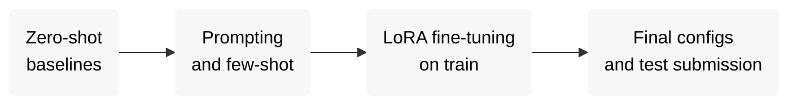

# MMCultureQA (SemEval-2027)

Our system for [SemEval-2027 Task 6: MMCultureQA](https://mmcultureqa-semeval27.github.io/), built as a semester project for the "Artificial Intelligence" course at UCU.

## Task

Given an image and a question about it, generate a short open-ended answer. The questions need local cultural knowledge, not only what is visible in the image.

| Task | Input | Output |
|---|---|---|
| **Task 1: Spoken VQA** | image + spoken question (audio) | short text answer |
| **Task 2: Textual VQA** | image + text question | short text answer |

- **Track:** QA in English for MENA countries.
- **Metrics:**
  - BERTScore F1 `official`, leaderboard metric
  - BLEU `official`
  - ROUGE-L `official`
  - Coverage `official`
  - WER (for Task 1 ASR)

## Team

| | Name | GitHub | Focus |
|:-:|---|---|---|
|  | Maryna Ohinska | [@mohinska](https://github.com/mohinska) | Task 2, Textual VQA: VLM selection, prompting, fine-tuning |
|  | Yaryna Pechenenko | [@PechenenkoYara](https://github.com/PechenenkoYara) | Task 1, Spoken VQA: ASR, cascade, end-to-end audio models |

## Data

Source: [QCRI/MMCQA-SemEval27](https://huggingface.co/datasets/QCRI/MMCQA-SemEval27) on Hugging Face.

| Split | Examples | Audio (Task 1) | Gold answers |
|---|---:|---|---|
| train | 10,000 | synthetic (TTS) | yes |
| dev | 1,000 | synthetic (TTS) | yes |
| devtest | 1,000 | synthetic (TTS) | no (answers are hidden, score by uploading) |
| test | released 10.01.2027 | real recordings | no |

Each example is one JSON line:

| Field | Description |
|---|---|
| `id` | SHA-256 of the image |
| `image` | path to the image, `images/<id>.jpg` |
| `question` | question text (Task 2) |
| `audio` | path to the spoken question (Task 1, replaces `question`) |
| `answer` | gold answer (absent in devtest and test) |

Example (`qa/mena/dev_en.jsonl`):

```json
{"id": "065bd70c...",
 "image": "images/065bd70c....jpg",
 "question": "What cultural significance do lanterns like the ones shown in the image have in traditional marketplaces?",
 "answer": "Lanterns like these often symbolize hospitality and are commonly used in traditional marketplaces for decoration and lighting, creating a warm and inviting atmosphere. They are particularly prevalent in Middle Eastern and North African cultures."}
```

Gold answers are often a full sentence or two (median 24 words on dev), not a single word. That matters for BERTScore and for how we prompt. Details: `shared/notebooks/00_EDA.ipynb`.

Layout after `download_data.py`:

```
data/
├── qa/mena/{train,dev,devtest}_en.jsonl     # Task 2: image + text question
├── sqa/mena/{train,dev,devtest}_en.jsonl    # Task 1: image + audio question
└── archives/
    ├── images/                               # unpacked from images_mena_{split}.zip
    └── audio/                                # unpacked from audio_mena_en_{split}.zip
```

## Pipeline



Task 1 is solved in two ways, so we can compare them:

| Approach | How | Why |
|---|---|---|
| **Cascade** | Whisper turns the audio into text, then the Task 2 VLM answers | simple and reuses the Task 2 model, but ASR errors (names, dishes, places) carry over into the answer |
| **End-to-end** | one multimodal model takes the image and the audio directly | no ASR step, so it may handle cultural terms better |

Comparing either one with Task 2 on the same examples shows how much is lost to speech.

## Baselines

### Candidates

All candidates are open-weight models that fit on a Kaggle T4 x2: **Qwen3-VL 4B and 8B** differ only in size and **Gemma 3 4B** is a different family of the same size as the 4B, so the comparison separates the effect of size from the effect of the model family. **Whisper large-v3-turbo** was the most accurate ASR we tried, and **Qwen2.5-Omni** is the open model that takes audio directly (the end-to-end setup) and the one used by the official baseline.

| Component | Candidates |
|---|---|
| VLM (Task 2, Task 1 cascade) | Qwen3-VL-8B-Instruct, Qwen3-VL-4B, Gemma 3 4B |
| ASR (Task 1 cascade) | Whisper large-v3-turbo |
| End-to-end audio model (Task 1) | Qwen2.5-Omni |
| Official reference baseline (not our model) | Qwen2.5-Omni-3B, 4-bit |

### Task 2 results on `dev`

| Model | Prompt | BERTScore-F1 | BLEU | ROUGE-L |
|---|---|---:|---:|---:|
| Qwen3-VL-4B-Instruct | plain | 0.7322 | 3.70 | 0.232 |
| Qwen3-VL-4B-Instruct | gold_style_v1 | **0.7915** | 11.57 | 0.324 |
| Qwen3-VL-8B-Instruct | plain | 0.7252 | 3.55 | 0.211 |
| Qwen3-VL-8B-Instruct | gold_style_v1 | 0.7880 | 11.48 | 0.329 |
| Gemma 3 4B | plain | 0.7070 | 3.22 | 0.204 |
| Gemma 3 4B | gold_style_v1 | 0.7690 | 7.35 | 0.273 |
| Qwen2.5-Omni-3B (official baseline) | official | 0.7396 | 6.91 | 0.251 |

### Task 1 results on `dev`

| System | BERTScore-F1 | WER |
|---|---:|---:|
| Cascade: Whisper large-v3-turbo + Qwen3-VL-4B-Instruct, `gold_style_v1` | **0.7912** | 0.0092 (0.0069 on all 1000) |
| Cascade: Whisper large-v3-turbo + Qwen3-VL-8B-Instruct, `gold_style_v1` | 0.7856 | 0.0092 |
| End-to-end: official Qwen2.5-Omni-3B baseline (4-bit) | 0.7382 | - |
| End-to-end: the same answers cut at the first newline (our post-processing) | 0.7547 | - |

ASR models on `dev`

| Whisper model | Parameters | Corpus WER | Questions transcribed exactly | Questions with a lost name |
|---|---:|---:|---:|---:|
| small.en | 244M | 0.90% | 90.6% | 19 |
| medium.en | 769M | 0.70% | 92.3% | 16 |
| **large-v3-turbo** (used in the cascade) | 809M | **0.69%** | **92.3%** | **15** |

## Plan



For Spoken VQA, the train and dev audio is synthetic while the test audio is real, so later work includes audio augmentation (noise, speed, reverb) and testing on our own recordings.

## Repository

```
mmculture-qa/
├── shared/                   # used by both tasks
│   ├── data.py               #   paths, load_split(), jsonl helpers, data checks
│   ├── metrics.py            #   wer(), evaluate() (wraps the official scorer)
│   ├── official_scorer/
│   ├── format_checker/
│   ├── make_submission.py
│   ├── download_data.py
│   └── notebooks/00_EDA.ipynb
├── t2_text/                  # Task 2, Textual VQA
│   ├── prompts.py            #   plain, gold_style_v1, official
│   ├── run_vlm.py            #   VLM on a split → preds/ (Kaggle)
│   └── notebooks/
│       ├── 01_baselines.ipynb       # zero-shot baselines, scoring
│       └── 02_error_analysis.ipynb  # F1 by question type, length
├── t1_speech/                # Task 1, Spoken VQA
│   ├── speech.py             #   ASR backends, WER, cascade inputs
│   ├── run_asr.py
│   ├── run_cascade.py
│   └── notebooks/
│       ├── 10_asr_whisper.ipynb
│       ├── 11_cascade.ipynb
│       └── 12_speech_vs_text.ipynb
├── results/                  # metrics (.json) per run
├── requirements.txt
├── .env.example
│
│   local, gitignored:
├── data/                     # dataset
├── asr/                      # ASR transcripts
├── preds/                    # model answers
└── submissions/              # prediction.zip
```

## Setup

```bash
git clone https://github.com/mohinska/mmculture-qa.git
cd mmculture-qa
python -m venv .venv && source .venv/bin/activate
pip install -r requirements.txt
cp .env.example .env
```

| `.env` variable | Meaning |
|---|---|
| `HF_TOKEN` | Hugging Face read token ([settings/tokens](https://huggingface.co/settings/tokens)) |
| `MMCQA_ROOT` | folder that contains `data/`. Empty = repo folder |
| `MMCQA_OUT` | where `asr/` and `preds/` are written. Empty = same as `MMCQA_ROOT` |

Download data:

```bash
python shared/download_data.py [SPLITS ...] [--task {qa,sqa,all}] [--no-media] [--list]
```

| Argument | Values | Default | Meaning |
|---|---|---|---|
| `SPLITS` | `train`, `dev`, `devtest` (one or more) | `dev` | which splits to download |
| `--task` | `qa` | `all` | Task 2: qa jsonl + images |
| | `sqa` | | Task 1: sqa jsonl + images + audio (+ qa jsonl as WER reference) |
| | `all` | | both tasks |
| `--no-media` | | off | jsonl only, skip image / audio zips |
| `--list` | | off | only list files in the dataset repo, download nothing |

## Outputs

| File | What it is |
|---|---|
| `preds/*.jsonl` | answers, one official submission row per line: `{"id", "answer", "lang"}`. Task, split, model and prompt are in the file name only. |
| `preds/*.scores.jsonl` | per-example official BERTScore: `id, p, r, f1` |
| `results/*.json` | official scorer output (`submission_result`) plus our own summary keys: `bertscore_f1`, `bleu`, `n`, `preds` |

## Running models

Generation runs on Kaggle (GPU T4 x2).

Import `t2_text/notebooks/01_baselines.ipynb` (Task 2) or `t1_speech/notebooks/11_cascade.ipynb` (Task 1); they clone the repo, install `requirements.txt` and run:

```bash
# Task 2
python t2_text/run_vlm.py --model <hf-id> --prompt-id <prompt> --split <split> --n <n>
# Task 1: ASR
python t1_speech/run_asr.py --model <asr-model> --split <split>
# Task 1: cascade
python t1_speech/run_cascade.py --model <hf-id> --prompt-id <prompt> --split <split> --n <n>
```

Download `preds/`, then score locally. Options: `--model`, `--prompt-id` (`plain` | `gold_style_v1`; `official` only for Qwen2.5-Omni), `--split`, `--n` (`0` = all), `--dtype`, `--load-4bit`; `run_cascade.py` adds `--asr`, `run_asr.py` takes `--backend`.

## Scoring

Scoring runs locally, in its own venv, apart from the VLM stack. Use the venv from Setup.

Score a preds file with `evaluate(preds_path, "dev")` from `shared/metrics.py` (see `t2_text/notebooks/01_baselines.ipynb`, section Scoring).

## Submitting

1. Run the model on the split to submit (devtest or test) with `--n 0` (all items), see Running models.
2. `python shared/make_submission.py --preds preds/<file>.jsonl` writes `submissions/<name>/prediction.zip` and runs the official format checker.
