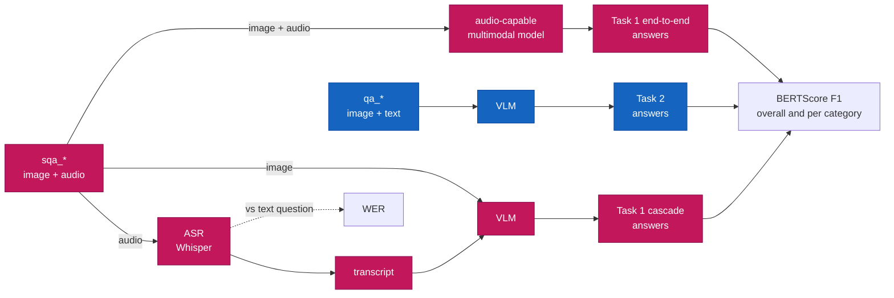
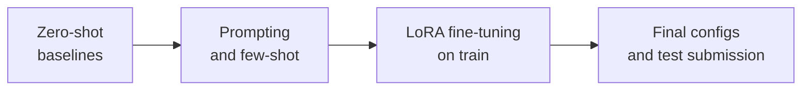

# MMCultureQA (SemEval-2027)

Our system for [SemEval-2027 Task 6: MMCultureQA](https://mmcultureqa-semeval27.github.io/), built as a semester project for the "Artificial Intelligence" course at UCU.

## Task

Given an image and a question about it, generate a short open-ended answer. The questions need local cultural knowledge, not only what is visible in the image.

| Task | Input | Output |
|---|---|---|
| **Task 1: Spoken VQA** | image + spoken question (audio) | short text answer |
| **Task 2: Textual VQA** | image + text question | short text answer |

- **Track:** English. The English data released so far covers the MENA region.
- **Metric:** BERTScore F1. For Spoken VQA we also track ASR word error rate (WER).
- **Evaluation:** CodaBench, 10–31 January 2027.

## Team

| | Name | GitHub | Focus |
|:-:|---|---|---|
|  | Maryna Ohinska | [@mohinska](https://github.com/mohinska) | Task 2, Textual VQA: VLM selection, prompting, fine-tuning |
|  | Yaryna Pechenenko | [@PechenenkoYara](https://github.com/PechenenkoYara) | Task 1, Spoken VQA: ASR, cascade, end-to-end audio models |

## Data

Source: [QCRI/MMCQA-SemEval27](https://huggingface.co/datasets/QCRI/MMCQA-SemEval27) on Hugging Face.

| Split | Examples | Audio | Labels |
|---|---:|---|---|
| train | 10,000 | synthetic (TTS) | yes |
| dev | 1,000 | synthetic (TTS) | yes |
| devtest | 1,000 | synthetic (TTS) | yes |
| test | released 10.01.2027 | real recordings | no |

Each example is one JSON line:

| Field | Description |
|---|---|
| `id` | SHA-256 of the image |
| `image` | path to the image, `images/<id>.jpg` |
| `question` | question text (Task 2) |
| `audio` | path to the spoken question (Task 1, replaces `question`) |
| `answer` | gold answer |
| `country`, `category`, `subcategory` | metadata, not in dev and test |

Example (`qa/mena/dev_en.jsonl`):

```json
{"id": "065bd70c...",
 "image": "images/065bd70c....jpg",
 "question": "What cultural significance do lanterns like the ones shown in the image have in traditional marketplaces?",
 "answer": "Lanterns like these often symbolize hospitality and are commonly used in traditional marketplaces for decoration and lighting, creating a warm and inviting atmosphere. They are particularly prevalent in Middle Eastern and North African cultures."}
```

Gold answers are often a full sentence or two (median 24 words on dev), not a single word. That matters for BERTScore and for how we prompt. Details: `shared/notebooks/00_EDA.ipynb`.

Layout after `download_data.py`:

```
data/
├── qa/mena/{train,dev,devtest}_en.jsonl     # Task 2: image + text question
├── sqa/mena/{train,dev,devtest}_en.jsonl    # Task 1: image + audio question
└── archives/
    ├── images/                               # unpacked from images_mena_{split}.zip
    └── audio/                                # unpacked from audio_mena_en_{split}.zip
```

## Pipeline



Task 1 is solved in two ways, so we can compare them:

| Approach | How | Why |
|---|---|---|
| **Cascade** | Whisper turns the audio into text, then the Task 2 VLM answers | simple and reuses the Task 2 model, but ASR errors (names, dishes, places) carry over into the answer |
| **End-to-end** | one multimodal model takes the image and the audio directly | no ASR step to break, so it may handle cultural terms better |

Comparing either one with Task 2 on the same examples shows how much is lost to speech.

## Baselines

To be decided after a zero-shot comparison on a 200-example dev subset. Candidates:

| Component | Candidates | Where it runs |
|---|---|---|
| VLM (Task 2, Task 1 cascade) | Qwen3-VL-8B-Instruct, Qwen3-VL-4B, Gemma 3 4B | Kaggle GPU |
| ASR (Task 1 cascade) | Whisper large-v3-turbo | Locally (`mlx-whisper`) |
| End-to-end audio model (Task 1) | Qwen2.5-Omni | Kaggle GPU |

Results:

| System | dev BERTScore F1 | dev WER |
|---|---:|---:|
| Task 2: VLM zero-shot | – | – |
| Task 1: Whisper + VLM (cascade) | – | – |
| Task 1: end-to-end | – | – |

## Plan



For Spoken VQA, the train and dev audio is synthetic while the test audio is real, so later work includes audio augmentation (noise, speed, reverb) and testing on our own recordings.

## Repository

```
mmculture-qa/
├── shared/               # used by both tasks
│   ├── data.py           #   paths, load_split(), load_jsonl() / save_jsonl(),
│   │                     #   check_ids(), check_media()
│   ├── metrics.py        #   wer(), wer_one(), bertscore(), evaluate()
│   ├── download_data.py  #   English data from Hugging Face → data/
│   └── notebooks/
│       └── 00_EDA.ipynb  #   answer length / style, countries, categories
├── t2_text/              # Task 2, Textual VQA
│   ├── prompts.py        #   build_prompt(), prompts: plain, gold_style_v1
│   ├── run_vlm.py        #   VLM on a dev subset → preds/ + BERTScore (Kaggle)
│   └── notebooks/
│       └── 01_baselines.ipynb  # zero-shot baselines on Kaggle
├── t1_speech/            # Task 1, Spoken VQA (planned)
│   └── notebooks/
├── results/              # metrics (.json) for every run, data_stats.json from EDA
├── requirements.txt
├── .env.example          # template for paths and HF_TOKEN
│
│   local directories:
├── data/                 # dataset
├── asr/                  # ASR transcripts
└── preds/                # model answers
```

## Setup

```bash
git clone https://github.com/mohinska/mmculture-qa.git
cd mmculture-qa
python -m venv .venv && source .venv/bin/activate
pip install -r requirements.txt
cp .env.example .env
```

| `.env` variable | Meaning |
|---|---|
| `HF_TOKEN` | Hugging Face read token ([settings/tokens](https://huggingface.co/settings/tokens)) |
| `MMCQA_ROOT` | folder that contains `data/`. Empty = repo folder |
| `MMCQA_OUT` | where `asr/` and `preds/` are written. Empty = same as `MMCQA_ROOT` |

Download data:

```bash
python shared/download_data.py [SPLITS ...] [--task {qa,sqa,all}] [--no-media] [--list]
```

| Argument | Values | Default | Meaning |
|---|---|---|---|
| `SPLITS` | `train`, `dev`, `devtest` (one or more) | `dev` | which splits to download |
| `--task` | `qa` | `all` | Task 2: qa jsonl + images |
| | `sqa` | | Task 1: sqa jsonl + images + audio (+ qa jsonl as WER reference) |
| | `all` | | both tasks |
| `--no-media` | | off | jsonl only, skip image / audio zips (enough for EDA) |
| `--list` | | off | only list files in the dataset repo, download nothing |

## Outputs

| File | Fields |
|---|---|
| `asr/{split}_en_{model}.jsonl` | `id, lang, split, model, transcript, wer` |
| `preds/{task}_{split}_en_{model}_{prompt_id}.jsonl` | `id, lang, split, task, model, prompt_id, pred` |
| `results/<same name>.json` | `bertscore_f1, bertscore_p, bertscore_r, n, by_category, date` |

`task` is one of `t1_speech_cascade`, `t1_speech_e2e`, `t2_text`. BERTScore uses `roberta-large` without baseline rescaling.

## Running on Kaggle

Add `HF_TOKEN` in Add-ons → Secrets, then:

```python
import os
from kaggle_secrets import UserSecretsClient
os.environ["HF_TOKEN"] = UserSecretsClient().get_secret("HF_TOKEN")
```

```bash
!git clone https://github.com/mohinska/mmculture-qa.git
%cd mmculture-qa
!pip install -q -r requirements.txt
%env MMCQA_OUT=/kaggle/working
!python shared/download_data.py dev --task qa
!pip install -q -U transformers   # Qwen3-VL needs a recent version
!python t2_text/run_vlm.py --model Qwen/Qwen3-VL-4B-Instruct --prompt-id gold_style_v1 --n 5
```

`run_vlm.py` arguments: `--model` (HF id), `--prompt-id` (`plain` | `gold_style_v1`), `--split` (default `dev`), `--n` (subset size, seed 0; default 200, `0` = full split). It is resumable: rerun the same command after a crash.
