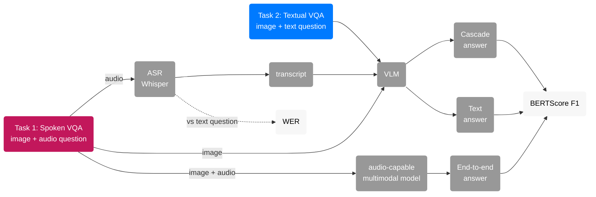
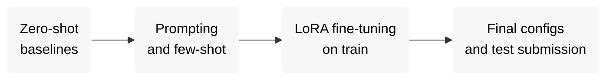

# MMCultureQA (SemEval-2027)

Our system for [SemEval-2027 Task 6: MMCultureQA](https://mmcultureqa-semeval27.github.io/), built as a semester project for the "Artificial Intelligence" course at UCU.

## Task

Given an image and a question about it, generate a short open-ended answer. The questions need local cultural knowledge, not only what is visible in the image.

| Task | Input | Output |
|---|---|---|
| **Task 1: Spoken VQA** | image + spoken question (audio) | short text answer |
| **Task 2: Textual VQA** | image + text question | short text answer |

- **Track:** English. The English data released so far covers the MENA region.
- **Metric:** BERTScore F1 from the [official scorer](https://github.com/mmcultureqa-semeval27/mmcultureqa/tree/main/scorer) (`jhu-clsp/mmBERT-base`, layer 17). BLEU, ROUGE-L and coverage are reported too. For Spoken VQA we also track ASR word error rate (WER); this is our own metric (jiwer on Whisper-normalized text, `shared/metrics.py`), the official scorer has no WER.
- **Evaluation:** CodaBench. The Dev-test leaderboard is open now. Test data is released 10.01.2027 and the evaluation period runs 10-31 January 2027.

## Team

| | Name | GitHub | Focus |
|:-:|---|---|---|
|  | Maryna Ohinska | [@mohinska](https://github.com/mohinska) | Task 2, Textual VQA: VLM selection, prompting, fine-tuning |
|  | Yaryna Pechenenko | [@PechenenkoYara](https://github.com/PechenenkoYara) | Task 1, Spoken VQA: ASR, cascade, end-to-end audio models |

## Data

Source: [QCRI/MMCQA-SemEval27](https://huggingface.co/datasets/QCRI/MMCQA-SemEval27) on Hugging Face.

| Split | Examples | Audio | Labels |
|---|---:|---|---|
| train | 10,000 | synthetic (TTS) | yes |
| dev | 1,000 | synthetic (TTS) | yes |
| devtest | 1,000 | synthetic (TTS) | no (answers are hidden, score by uploading) |
| test | released 10.01.2027 | real recordings | no |

Each example is one JSON line:

| Field | Description |
|---|---|
| `id` | SHA-256 of the image |
| `image` | path to the image, `images/<id>.jpg` |
| `question` | question text (Task 2) |
| `audio` | path to the spoken question (Task 1, replaces `question`) |
| `answer` | gold answer |
| `country`, `category`, `subcategory` | metadata, not in dev and test |

Example (`qa/mena/dev_en.jsonl`):

```json
{"id": "065bd70c...",
 "image": "images/065bd70c....jpg",
 "question": "What cultural significance do lanterns like the ones shown in the image have in traditional marketplaces?",
 "answer": "Lanterns like these often symbolize hospitality and are commonly used in traditional marketplaces for decoration and lighting, creating a warm and inviting atmosphere. They are particularly prevalent in Middle Eastern and North African cultures."}
```

Gold answers are often a full sentence or two (median 24 words on dev), not a single word. That matters for BERTScore and for how we prompt. Details: `shared/notebooks/00_EDA.ipynb`.

Layout after `download_data.py`:

```
data/
├── qa/mena/{train,dev,devtest}_en.jsonl     # Task 2: image + text question
├── sqa/mena/{train,dev,devtest}_en.jsonl    # Task 1: image + audio question
└── archives/
    ├── images/                               # unpacked from images_mena_{split}.zip
    └── audio/                                # unpacked from audio_mena_en_{split}.zip
```

## Pipeline



Task 1 is solved in two ways, so we can compare them:

| Approach | How | Why |
|---|---|---|
| **Cascade** | Whisper turns the audio into text, then the Task 2 VLM answers | simple and reuses the Task 2 model, but ASR errors (names, dishes, places) carry over into the answer |
| **End-to-end** | one multimodal model takes the image and the audio directly | no ASR step to break, so it may handle cultural terms better |

Comparing either one with Task 2 on the same examples shows how much is lost to speech.

## Baselines

Model choice is still open: zero-shot comparison on a 200-example dev subset is in progress. Qwen3-VL 4B and 8B have predictions for both prompts; Gemma 3 4B returned only empty answers in fp16 (rerun with bfloat16 in `01_baselines.ipynb`). Candidates:

| Component | Candidates | Where it runs |
|---|---|---|
| VLM (Task 2, Task 1 cascade) | Qwen3-VL-8B-Instruct, Qwen3-VL-4B, Gemma 3 4B | Colab / Kaggle GPU |
| ASR (Task 1 cascade) | Whisper large-v3-turbo | Kaggle / Colab GPU (`transformers`), or locally (`mlx-whisper` on Apple Silicon, `faster-whisper` on CPU) |
| End-to-end audio model (Task 1) | Qwen2.5-Omni | Colab / Kaggle GPU |
| Official reference baseline (not our model) | Qwen2.5-Omni-3B, 4-bit | Colab (`run_vlm.py`, prompt `official`) |

Task 2 results on dev (official scorer). `-` = not run yet.

| Model | Prompt | n | BERTScore-F1 | BLEU | ROUGE-L | Coverage |
|---|---|---:|---:|---:|---:|---:|
| Qwen3-VL-4B-Instruct | plain | 200 | 0.7322 | 3.70 | 0.232 | 1.0 |
| Qwen3-VL-4B-Instruct | gold_style_v1 | 200 | **0.7915** | 11.57 | 0.324 | 1.0 |
| Qwen3-VL-8B-Instruct | plain | 200 | 0.7252 | 3.55 | 0.211 | 1.0 |
| Qwen3-VL-8B-Instruct | gold_style_v1 | 200 | 0.7880 | 11.48 | 0.329 | 1.0 |
| Gemma 3 4B | plain | 200 | - | - | - | - |
| Gemma 3 4B | gold_style_v1 | 200 | - | - | - | - |
| Qwen2.5-Omni-3B (official reference baseline) | official | 1000 | - | - | - | - |

Rows with different n are not directly comparable. To compare the Omni file with the others, score it on our 200 ids by filtering its rows to the ids of `load_split("qa", "dev", n=200, seed=0)`.

Task 1 summary:

| System | dev BERTScore F1 | dev WER |
|---|---:|---:|
| Task 2 best so far: Qwen3-VL-4B-Instruct, `gold_style_v1`, n=200 | 0.791 | - |
| Task 1: Whisper large-v3-turbo + Qwen3-VL-4B-Instruct (cascade), `gold_style_v1`, n=200 | - | 0.0069 (n=1000) |
| Task 1: end-to-end | - | - |

## Plan



For Spoken VQA, the train and dev audio is synthetic while the test audio is real, so later work includes audio augmentation (noise, speed, reverb) and testing on our own recordings.

## Repository

```
mmculture-qa/
├── shared/               # used by both tasks
│   ├── data.py           #   paths, load_split(), load_jsonl() / save_jsonl(),
│   │                     #   check_ids(), check_media()
│   ├── metrics.py        #   wer(), wer_one(), evaluate() (wraps the official scorer)
│   ├── official_scorer/  #   upstream scorer, bundled unmodified (Apache 2.0)
│   ├── format_checker/   #   upstream submission format checker, bundled unmodified
│   ├── make_submission.py #  preds → submissions/<name>/prediction.zip + format check
│   ├── download_data.py  #   English data from Hugging Face → data/
│   └── notebooks/
│       └── 00_EDA.ipynb  #   answer length / style, countries, categories
├── t2_text/              # Task 2, Textual VQA
│   ├── prompts.py        #   build_prompt(), prompts: plain, gold_style_v1, official
│   ├── run_vlm.py        #   VLM (Qwen3-VL, Gemma, Qwen2.5-Omni) on a split → preds/ (Colab / Kaggle, generation only)
│   └── notebooks/
│       ├── 01_baselines.ipynb       # zero-shot baselines: generation on Colab, scoring locally
│       └── 02_error_analysis.ipynb  # BERTScore by question type, length, worst answers
├── t1_speech/            # Task 1, Spoken VQA
│   ├── speech.py         #   ASR (mlx / faster-whisper / hf backends), WER summary,
│   │                     #   cascade inputs, T1 vs T2 join
│   ├── run_asr.py        #   Whisper on a split → asr/ + results/asr_*.json
│   ├── run_cascade.py    #   transcripts + images → the T2 VLM → preds/ (generation only)
│   └── notebooks/
│       ├── 10_asr_whisper.ipynb      # ASR and WER
│       ├── 11_cascade.ipynb          # cascade + T2 twin + scoring (Kaggle / Colab)
│       └── 12_speech_vs_text.ipynb   # T1 vs T2 comparison by WER bin
├── results/              # metrics (.json) for every run, data_stats.json from EDA
├── requirements.txt
├── .env.example          # template for paths and HF_TOKEN
│
│   local directories:
├── data/                 # dataset
├── asr/                  # ASR transcripts
└── preds/                # model answers
```

## Setup

```bash
git clone https://github.com/mohinska/mmculture-qa.git
cd mmculture-qa
python -m venv .venv && source .venv/bin/activate
pip install -r requirements.txt
cp .env.example .env
```

| `.env` variable | Meaning |
|---|---|
| `HF_TOKEN` | Hugging Face read token ([settings/tokens](https://huggingface.co/settings/tokens)) |
| `MMCQA_ROOT` | folder that contains `data/`. Empty = repo folder |
| `MMCQA_OUT` | where `asr/` and `preds/` are written. Empty = same as `MMCQA_ROOT` |

Download data:

```bash
python shared/download_data.py [SPLITS ...] [--task {qa,sqa,all}] [--no-media] [--list]
```

| Argument | Values | Default | Meaning |
|---|---|---|---|
| `SPLITS` | `train`, `dev`, `devtest` (one or more) | `dev` | which splits to download |
| `--task` | `qa` | `all` | Task 2: qa jsonl + images |
| | `sqa` | | Task 1: sqa jsonl + images + audio (+ qa jsonl as WER reference) |
| | `all` | | both tasks |
| `--no-media` | | off | jsonl only, skip image / audio zips (enough for EDA) |
| `--list` | | off | only list files in the dataset repo, download nothing |

## Outputs

| File | Fields |
|---|---|
| `asr/{split}_en_{model}.jsonl` | `id, row_idx, lang, split, model, backend, transcript, wer` |
| `preds/{task}_{split}_en_{model}_{prompt_id}.jsonl` | `id, answer, lang` (official submission row; task, split, model and prompt are in the file name) |
| `preds/<same name>.scores.jsonl` | per-example official BERTScore: `id, p, r, f1` (0 for empty answers) |
| `results/<same name>.json` | the official result (`submission_result`: `BERTScore-F1/P/R, BLEU, ROUGE-L, Coverage`) plus flat keys `preds, split, n, n_missing, bertscore_f1/p/r, bleu, rouge_l, coverage, bertscore_model, bertscore_layer, bertscore_revision, by_category (if gold has it), date` |
| `results/asr_<asr file>.json` | `asr, split, n, wer_corpus, wer_mean, share_wer0, share_wer_gt_0.25` |
| `results/t1_vs_t2_*.json / .png` | T1 vs T2 comparison from `12_speech_vs_text.ipynb` |

`task` is one of `t1_speech_cascade`, `t1_speech_e2e`, `t2_text`. Scores come from the official scorer: `mmBERT-base` layer 17, no idf, no rescaling, empty answer = 0.

## Scoring

Scoring runs locally, in its own venv, apart from the VLM stack (the scorer needs torch >= 2.6; `requirements.txt` installs it on Apple Silicon Macs). Scoring needs an Apple-Silicon Mac, Linux, Colab or Kaggle: there are no torch 2.6 wheels for Intel Macs. The first run downloads about 1 GB of mmBERT weights. Use the venv from Setup.

There is one scoring path: `evaluate(preds_path, "dev")` from `shared/metrics.py`, which the "Scoring" section of `t2_text/notebooks/01_baselines.ipynb` calls for every preds file. A preds file in the old `pred` format raises an error instead of being scored. An optional cell at the end of the notebook cross-checks the first file against the standalone `shared/official_scorer/score.py` (BERTScore-F1 should match to 4 decimals).

## Submitting

1. `python shared/download_data.py devtest --task qa` (images and jsonl).
2. On Kaggle: `run_vlm.py --split devtest --n 0` (full 1000 items), download the preds file.
3. `python shared/make_submission.py --preds preds/t2_text_devtest_en_<model>_<prompt>.jsonl` writes `submissions/<name>/prediction.zip` and runs the official format checker (`format OK` expected).
4. Upload the zip to the Dev-test leaderboard with track `en`. n=200 subsets fail the id check by design: the checker needs every id of the split.

Task 1 (cascade) uses the same steps with the speech data: `download_data.py devtest --task sqa`, then on Kaggle `run_asr.py --split devtest` and `run_cascade.py --split devtest --n 0`, then `make_submission.py --preds preds/t1_speech_cascade_devtest_en_<asr>+<model>_<prompt>.jsonl`. The id check reads the qa file, which is correct here: qa and sqa have the same ids on dev and devtest.

## Running on Kaggle (generation only)

Add `HF_TOKEN` in Add-ons → Secrets, then:

```python
import os
from kaggle_secrets import UserSecretsClient
os.environ["HF_TOKEN"] = UserSecretsClient().get_secret("HF_TOKEN")
```

```bash
!git clone https://github.com/mohinska/mmculture-qa.git
%cd mmculture-qa
!pip install -q -r requirements.txt
%env MMCQA_OUT=/kaggle/working
!python shared/download_data.py dev --task qa
!python t2_text/run_vlm.py --model Qwen/Qwen3-VL-4B-Instruct --prompt-id gold_style_v1 --n 5
```

Download `/kaggle/working/preds/` and score it locally (see Scoring).

## Running on Colab (generation only)

`t2_text/notebooks/01_baselines.ipynb` has the Colab setup (secret `HF_TOKEN`, clone, pinned `pip install`, `MMCQA_OUT=/content`) and run cells for Qwen2.5-Omni-3B (4-bit) and Gemma 3 4B on a T4. Download `/content/preds` and score it locally.

`run_vlm.py` arguments: `--model` (HF id), `--prompt-id` (`plain` | `gold_style_v1` | `official`), `--split` (default `dev`; `devtest` works, no gold needed), `--n` (subset size, seed 0; default 200, `0` = full split), `--dtype` (`float16` default | `bfloat16` | `float32`), `--load-4bit` (bitsandbytes NF4), `--max-new-tokens` (default 96, 64 for Omni). For Qwen2.5-Omni (needs `qwen-omni-utils`, installed by `requirements.txt` on Linux) the official message layout is used and the prompt id is forced to `official`. It is resumable: rerun the same command after a crash.

## Task 1: ASR and cascade

`t1_speech/notebooks/11_cascade.ipynb` runs the whole chain on Kaggle or Colab: Whisper on dev, the cascade, its T2_Text twin with the same model, prompt and ids, scoring with the official scorer, and a zip of `asr/`, `preds/` and `results/`. `12_speech_vs_text.ipynb` then runs locally on the downloaded files (no torch needed).

```bash
python t1_speech/run_asr.py --split dev
python t1_speech/run_cascade.py --model Qwen/Qwen3-VL-4B-Instruct --prompt-id gold_style_v1 --n 200
```

`run_asr.py` arguments: `--model` (key of `ASR_MODELS` in `speech.py`, default `whisper-large-v3-turbo`), `--split`, `--n` (`0` = full split, default), `--seed` (default 0), `--backend` (`mlx` | `ct2` | `hf`, default: auto), `--initial-prompt` (decoder context, mlx / ct2 only), `--tag` (output name, required with `--initial-prompt`), `--batch-size`. The backend is `mlx` on Apple Silicon, `hf` on a CUDA GPU and `ct2` (faster-whisper, CPU) otherwise; all decode greedily. The `hf` backend reads audio with `ffmpeg`, preinstalled on Kaggle and Colab.

`run_cascade.py` arguments: as `run_vlm.py` (`--model`, `--prompt-id` `plain` | `gold_style_v1`, `--split`, `--n`, `--dtype`, `--load-4bit`, `--max-new-tokens`) plus `--asr` (ASR run name, default `whisper-large-v3-turbo`). It writes `preds/t1_speech_cascade_{split}_en_{asr short}+{model}_{prompt}.jsonl`, e.g. `whisperturbo+Qwen3-VL-4B-Instruct_gold_style_v1`. Qwen2.5-Omni is refused: it takes the audio itself, which is the end-to-end setup.
